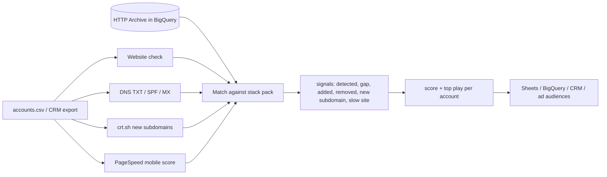

# How it works

The bundle never logs in anywhere and never uses paid data. It reads what every company already publishes: the code its website loads, its public DNS records, its public SSL certificates, and its page speed. HTTP Archive adds a monthly, internet-scale version of the website check inside BigQuery.

## The five sources

### 1. Live website check (free)

The CLI fetches `https://<domain>` (falling back to `https://www.<domain>`) plus any `extra_paths` in the pack, for example `/meetings` for hotels or `/pricing` for SaaS. It then matches:

- **HTML patterns:** script `src`, link `href`, iframe URLs, inline snippets. Patterns that look like hosts (`be.synxis.com`) only match at a host boundary, so `olo.com` never matches `polo.com`.
- **Header patterns:** for example `server: cloudflare` or the presence of `x-vercel-id`.

Patterns pointing at the account's own domain are skipped, so scanning a vendor doesn't "detect" that vendor.

**Limits:** sites that block bots return an error (shown in the `errors` column). Tools loaded only after a click, or only inside a tag manager, may be missed. Pages behind a login are never seen.

### 2. DNS records (free)

- **MX** shows the email provider and email security gateway: Google Workspace, Microsoft 365, Proofpoint, Mimecast.
- **SPF** (`v=spf1 ...`) shows which services send email as the company: HubSpot, Marketo, Salesforce, SendGrid, Mailchimp, Amazon SES, Zendesk.
- **TXT verification tokens** are left behind when a company signs up for a SaaS tool and proves it owns the domain: `atlassian-domain-verification`, `docusign=`, `facebook-domain-verification`, `adobe-idp-site-verification`, `ZOOM_verify_`, `slack-domain-verification`, `MS=`.

The CLI uses `dnspython` if installed, otherwise DNS-over-HTTPS (`https://dns.google/resolve`, override with `FOOTPRINT_DOH_URL`). The n8n workflow always uses DNS-over-HTTPS.

**Limits:** a verification token shows a sign-up, not how heavily the tool is used. Old tokens are often left in place after a company churns.

### 3. Certificate transparency logs via crt.sh (free)

Every public SSL certificate is logged. Querying `crt.sh` for `%.domain.com` lists every subdomain that has ever had a certificate and when it first appeared. A new `events.` or `book.` subdomain usually means a launch or a new tool. Only subdomains listed in the pack's `interesting_subdomains` become signals.

**Limits:** crt.sh is a free community service and can be slow or time out. The scan only calls it with `--crtsh`. Wildcard certificates hide individual subdomains.

### 4. PageSpeed Insights (free)

Google runs Lighthouse on the homepage and returns a mobile performance score (0 to 100). Below 50 becomes a `slow_site` signal: a concrete, verifiable opener for agencies, CMS vendors, booking engines, ecommerce apps and anyone selling conversion.

Works without a key at low volume. For lists, create a free key in Google Cloud and set `PAGESPEED_API_KEY` in `.env`.

### 5. HTTP Archive in BigQuery (free data, you pay for scans)

[HTTP Archive](https://httparchive.org) crawls millions of websites every month and runs Wappalyzer-style technology detection on each page. The results are a public BigQuery dataset (`httparchive.crawl.pages`, column `technologies`). `bigquery/10_httparchive_match.sql` joins it to your accounts.

Best for: very large account lists, checking accounts without touching their sites, and history (compare months).

**Limits:** only sites with enough real-world traffic are crawled, so small single-location businesses may be missing. It refreshes monthly. Tables are very large: read [bigquery-setup.md](bigquery-setup.md) first.

## From detections to plays

Each tool found is labelled using the pack's `seller` block:

| Role | Rule | Weight (default) | Play |
|---|---|---|---|
| competitor | tool id in `seller.competitors` | 30 | `competitor_found` |
| complement | tool id in `seller.complements` | 15 | `complement_found` |
| neutral | anything else | 0 (still recorded) | none |
| gap | category in `seller.must_have_categories` with no tool found (only if the site loaded) | 20 | `gap_found` |

Then:

- **Changes:** each scan saves a snapshot in `out/snapshots/<pack>/<date>.jsonl`. The next scan compares against the latest previous snapshot and emits `tech_added` (25) and `tech_removed` (20, or 35 when a competitor disappears, the switch window).
- **New subdomains:** 10 each.
- **Slow site:** 10.

The account score is the sum, capped at 100. `top_play` is the play of the highest-weight signal. Change weights or play names per pack.

## Output files

| File | Use |
|---|---|
| `out/accounts_summary.csv` | The working list. One row per account, sorted by score. Open in Sheets, filter by `top_play`, hand to SDRs or build ad audiences. |
| `out/signals.csv` | Every signal with `evidence` and `evidence_url`, so a rep can verify before reaching out. |
| `out/signals.jsonl` | Same rows for `bq load` into `abm.signals`. |
| `out/snapshots/` | History for change detection. Keep this folder between runs. |
